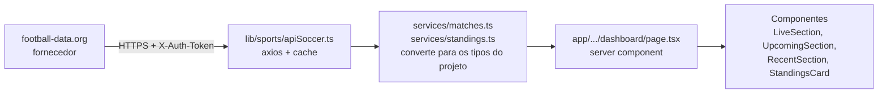

# Trabalho DashBoard NextJS versão 16

## Proposta: 

A proposta do trabalho é fazer duas páginas utilizando a navegação do NextJS. 
- Tela de Login.
- Tela de DashBoard com link para uma listagem de partidas de esportes e e-sports.

## Minha ideia:

Ao logar, abre uma Dash com quantas partidas de CS, Brasileirão série A, UEFA Champions League e corridas da Fórmula 1 vão acontecer na data atual. E numa segunda tela mostrar detalhes dos campeonatos (ultimos jogos com resultados, partidas nos próximos dias da semana, link de onde assistir, etc.), Conforme a idéia for evoluindo vou registrando aqui.

## Estrutura: 

### Login:

### DashBoard:

## Como funciona a API de futebol no sportsTrack

Este documento explica o caminho completo dos dados de futebol: de onde eles vêm, como são tratados e como chegam aos componentes da dashboard.

### 1. Visão geral



Em uma frase: o **fornecedor** manda dados no formato dele, o **service** traduz esses dados para o formato do nosso projeto, a **página** busca tudo de uma vez e cada **componente** só desenha o que recebe.

Os componentes nunca falam com a API. Isso mantém a chave fora do navegador e permite trocar de fornecedor mexendo só nos services.

### 2. O fornecedor: football-data.org

| Item | Valor |
|---|---|
| URL base | `https://api.football-data.org/v4` |
| Autenticação | header `X-Auth-Token` com a chave pessoal |
| Plano gratuito | 12 competições, dados básicos (partidas, resultados e tabelas) e **10 chamadas por minuto** |

Competições que usamos (códigos da API):

| Código | Competição |
|---|---|
| `BSA` | Campeonato Brasileiro Série A |
| `CL` | UEFA Champions League |

Endpoints usados:

- `GET /competitions/{código}/matches?dateFrom=AAAA-MM-DD&dateTo=AAAA-MM-DD`: partidas de uma competição em uma janela de datas.
- `GET /competitions/{código}/standings`: tabela de classificação.

A API responde com **objetos**, por exemplo `{ matches: [...] }` e `{ standings: [...] }`, e não com listas soltas.

### 3. Configuração (`.env`)

```
API_SOCCER_URL=https://api.football-data.org/v4
API_SOCCER_KEY=sua_chave
```

As variáveis **não** começam com `NEXT_PUBLIC_`, então só existem no servidor. Depois de editar o `.env`, reinicie o `npm run dev`.

### 4. O cliente HTTP: `lib/sports/apiSoccer.ts`

Este arquivo é a única porta de entrada para a API de futebol. Ele faz três coisas:

1. **Cria a instância do axios** com a URL base e o header `X-Auth-Token`.
2. **Expõe `getData<T>(path, params)`**, que faz o GET e devolve sempre `{ data, error }`. Ele nunca lança exceção: se a API falhar (chave errada, limite estourado, competição fora do plano, internet fora), devolve `{ data: undefined, error: true }` e escreve o motivo no terminal do servidor (`[apiSoccer] ... 429`).
3. **Guarda um cache de 60 segundos** em memória. Se duas partes do código pedirem a mesma URL ao mesmo tempo, só uma requisição sai e as duas dividem a resposta. Respostas com erro não ficam no cache.

Por que o cache existe: o limite é de 10 chamadas por minuto. Sem ele, a página e o `LiveRefresher` estourariam esse limite rapidamente.

Códigos de erro comuns, que aparecem no terminal:

| Código | Significado |
|---|---|
| 400 | parâmetro inválido (por exemplo, janela de datas grande demais) |
| 403 | competição fora do plano gratuito |
| 429 | limite de 10 chamadas por minuto excedido |

### 5. Os services: traduzindo os dados

Os services transformam o formato do fornecedor no formato do projeto (`src/types/sports.ts`). Assim, nenhum componente precisa saber como a API nomeia os campos.

#### 5.1 `services/matches.ts`

Faz **uma chamada por competição** (`BSA` e `CL`), pedindo uma janela de datas: 10 dias para trás e 14 para frente. Dessa única resposta saem as três listas da dashboard:

| Função | Filtro | Ordem | Limite |
|---|---|---|---|
| `getLiveMatches` | `status === "live"` | início crescente | todas |
| `getUpcomingMatches` | `status === "scheduled"` | início crescente | `LIMITS.upcoming` |
| `getRecentMatches` | `status === "finished"` | início decrescente | `LIMITS.recent` |

As três chamam a mesma função interna (`loadSoccerMatches`), e o cache faz com que isso gere apenas 2 requisições, não 6.

**Como o status da API vira o status do projeto:**

| Status da API | Status no projeto |
|---|---|
| `IN_PLAY`, `PAUSED`, `EXTRA_TIME`, `PENALTY_SHOOTOUT` | `live` |
| `FINISHED`, `AWARDED` | `finished` |
| `SCHEDULED`, `TIMED` | `scheduled` |
| `POSTPONED`, `CANCELLED`, `SUSPENDED` | descartado |

**Como cada campo é traduzido (`toMatch`):**

| Campo da API | Campo no projeto (`Match`) |
|---|---|
| `id` | `id` (como texto) |
| `utcDate` | `startsAt` |
| `status` | `status` (tabela acima) |
| `minute` | `clock` (ex.: `67'`; `Intervalo` quando pausado; `Ao vivo` se não houver minuto) |
| `competition.name` | `league` |
| `matchday` | `detail` (ex.: `Rodada 33`) |
| `homeTeam` / `awayTeam` | `home` / `away` (`tla` vira `shortName`, `crest` vira `logoUrl`) |
| `score.fullTime.home` / `.away` | `homeScore` / `awayScore` |

Se o campo `sport` do filtro for diferente de futebol, os services devolvem lista vazia. Fórmula 1 e Counter-Strike virão de outras APIs.

### 5.2 `services/standings.ts`

Chama `/competitions/{código}/standings`, escolhe a tabela do tipo `TOTAL` (a API também envia mandante e visitante separados), converte cada linha para `StandingRow`, ordena por posição e entrega só o topo (`LIMITS.standings`).

### 6. Os tipos: o contrato entre services e componentes

Em `src/types/sports.ts`:

- `Match`: uma partida (times, placar, status, horário, campeonato).
- `StandingRow`: uma linha da tabela (posição, time, jogos, pontos).
- `ApiResult<T>`: o envelope `{ data: T, error: boolean }` usado por todos os services.

O `error` existe para os componentes diferenciarem **"não há dados"** de **"a API falhou"**.

## 7. A página: `app/(pages)/dashboard/page.tsx`

A página é um **server component**: roda no servidor a cada acesso (`dynamic = "force-dynamic"`), então a chave nunca chega ao navegador.

O que ela faz, em ordem:

1. Lê `?sport=` e `?q=` da URL (filtro de esporte e busca).
2. Dispara todas as buscas ao mesmo tempo com `Promise.all`: partidas ao vivo, próximas, recentes, próxima corrida e as tabelas.
3. Aplica a busca por texto (`filterByQuery`) nas listas de partidas.
4. Monta o resumo ("2 partidas ao vivo agora · 8 próximas").
5. Entrega a cada componente o seu `result` (o `ApiResult`) já pronto.

Como o filtro de esporte é um link (`/?sport=futebol`), a página inteira é gerada de novo no servidor, sem JavaScript no cliente.

### 8. Os componentes: só desenham

| Componente | Recebe | O que mostra |
|---|---|---|
| `LiveSection` → `LiveMatchCard` | `ApiResult<Match[]>` | cards de jogos ao vivo com placar e minuto |
| `UpcomingSection` → `MatchRow` | `ApiResult<Match[]>` | próximos jogos com dia e hora |
| `RecentSection` → `MatchRow` | `ApiResult<Match[]>` | resultados recentes com placar |
| `StandingsCard` | `ApiResult<StandingRow[]>` | tabela do Brasileirão |
| `TeamBadge` | `Team` | escudo (`logoUrl`) ou sigla colorida |
| `EmptyState` | `message`, `error` | aviso de lista vazia ou de falha |

Regras que valem para todos:

- Lista com itens: mostra os itens.
- Lista vazia com `error: false`: mostra a mensagem "sem dados" daquela seção.
- Lista vazia com `error: true`: mostra "Não foi possível carregar os dados agora".

O `LiveRefresher` é o único componente de cliente: a cada 30 segundos ele manda a página buscar tudo de novo no servidor, para o placar se atualizar sozinho.

### 9. Quantas chamadas a API recebe?

Um carregamento da dashboard gera **3 requisições**: partidas de `BSA`, partidas de `CL` e a tabela de `BSA`. Com o cache de 60 segundos, o `LiveRefresher` (30 s) usa o cache em uma recarga e busca dados novos na seguinte, algo em torno de 3 chamadas por minuto, abaixo do limite de 10.

Consequência: **o placar ao vivo atualiza no máximo a cada 60 segundos**.

### 10. Como adicionar uma competição

1. Descubra o código dela (por exemplo, `PL` para a Premier League) e confira se está entre as 12 do plano gratuito.
2. Inclua o código em `COMPETITIONS` e em `SOCCER_COMPETITIONS` (`lib/config.ts`).
3. Pronto: `matches.ts` passa a incluí-la nas três listas. Cada competição nova soma 1 requisição por carregamento.

### 11. Pontos a confirmar

- O plano gratuito lista "partidas, resultados e tabelas". A documentação consultada não diz se o placar ao vivo e o minuto vêm com atraso ou ficam indisponíveis. Se `clock` aparecer sempre como "Ao vivo", é por isso.
- Os nomes dos campos de cada partida (`homeTeam`, `score.fullTime` etc.) não aparecem nos exemplos da documentação lida. Confira com um `console.log` da primeira partida no service.
- A documentação não informa o tamanho máximo da janela de datas. Se a API responder 400, reduza `MATCH_WINDOW_DAYS` em `lib/config.ts`.


## Utils:

APIs para buscar os dados dos campeonatos: 
- API-Sports
- TheSportsDB
- Sportmonks
- PandaScore API